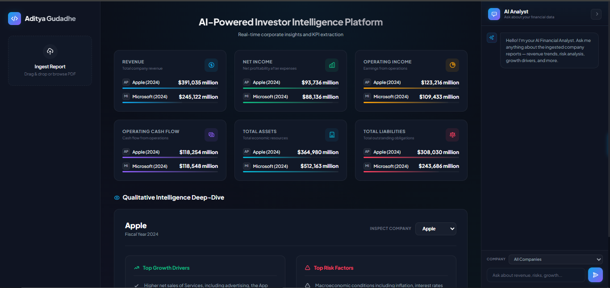
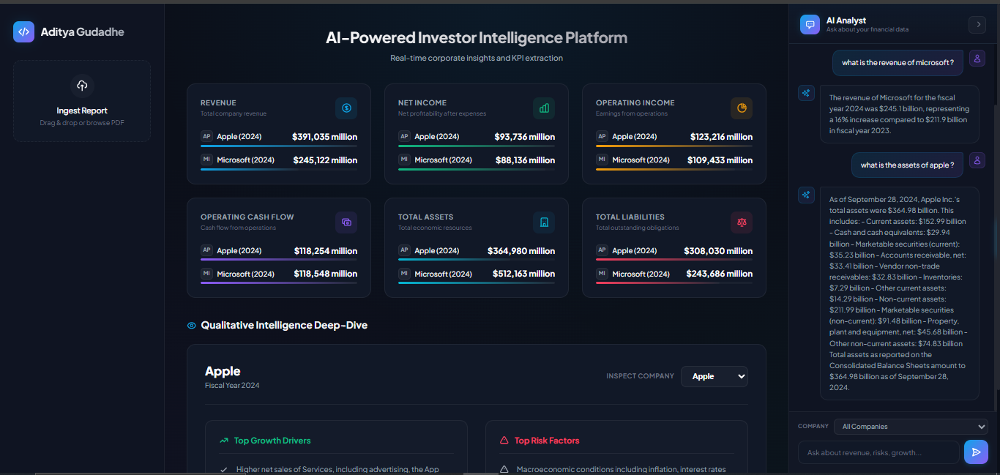
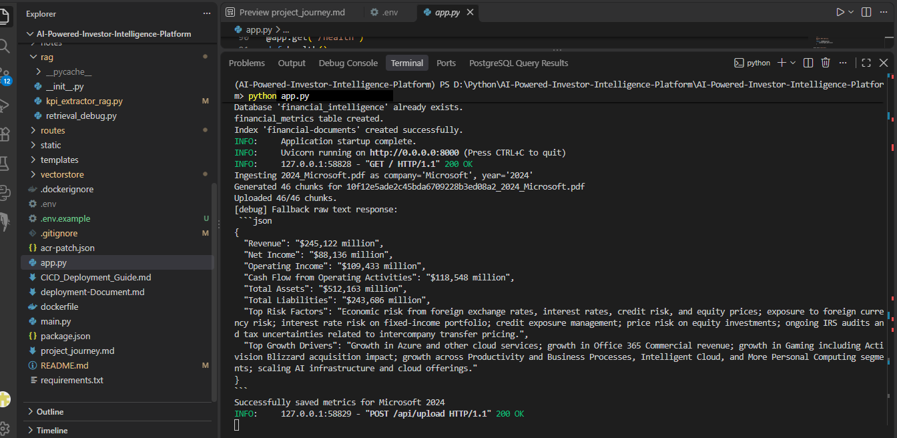
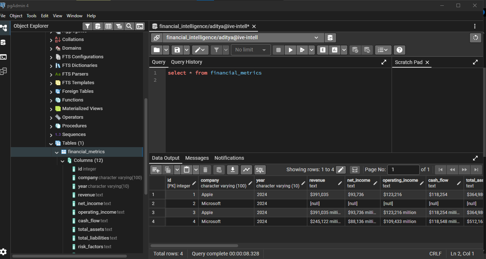

# AI-Powered Investor Intelligence Platform

A FastAPI backend that ingests annual-report PDFs, indexes report sections in Azure AI Search, extracts selected financial metrics with Azure OpenAI, and stores the results in PostgreSQL. The project is a portfolio prototype: cloud services and credentials are required for end-to-end ingestion and chat.

## What it does

- Accepts PDF report uploads through `POST /api/upload` (PDF only, up to 25 MB).
- Converts reports to Markdown and semantic chunks, then indexes chunks for retrieval.
- Extracts revenue, income, cash flow, assets, liabilities, risks, and growth drivers from retrieved passages.
- Answers questions using retrieved report context through `POST /api/chat`.
- Displays saved metrics in the dashboard and exposes them through `GET /api/metrics`.
- Exposes `GET /health` for a basic process health check.
## Screenshots

### Dashboard
Compare Apple and Microsoft financial metrics.



### AI analyst
Ask questions about company reports.



### Report extraction
See the extracted metrics after report processing.



### Database
View extracted metrics stored in PostgreSQL.


## Architecture

```text
PDF upload -> PDF/Markdown conversion -> semantic chunks -> Azure AI Search
                                                    |             |
                                                    +-> Azure OpenAI extraction
                                                              |
                                                        PostgreSQL -> dashboard
```

The primary web application is `app.py` (port 8000). `main.py` is a smaller API entry point for health and dashboard routes; use `app.py` for the complete application.

## Requirements

- Python 3.12+
- Azure AI Search service and an index matching the fields created in `vectorstore/create_index.py`
- Azure OpenAI deployments for chat and embeddings
- PostgreSQL database/user with permission to create the configured database (or a database that already exists)

## Local setup

```powershell
py -3.12 -m venv .venv
.venv\Scripts\Activate.ps1
python -m pip install -r requirements.txt
Copy-Item .env.example .env
```

Fill in `.env` with the configuration below, then start the application:

```powershell
python app.py
```

Open `http://localhost:8000/docs` for the interactive API reference and `http://localhost:8000/` for the dashboard.

## Configuration

| Variable | Purpose |
| --- | --- |
| `AZURE_SEARCH_ENDPOINT` | Azure AI Search service endpoint |
| `AZURE_SEARCH_API_KEY` | Azure AI Search key |
| `AZURE_SEARCH_INDEX_NAME` | Index name used by ingestion and retrieval |
| `AZURE_OPENAI_ENDPOINT` | Azure OpenAI endpoint |
| `AZURE_OPENAI_API_KEY` | Azure OpenAI key |
| `AZURE_OPENAI_API_VERSION` | Azure OpenAI API version supported by the resource |
| `AZURE_OPENAI_CHAT_DEPLOYMENT` | Chat model deployment name |
| `AZURE_OPENAI_EMBEDDING_DEPLOYMENT` | Embedding deployment name |
| `POSTGRES_HOST` | PostgreSQL host |
| `POSTGRES_PORT` | PostgreSQL port (usually `5432`) |
| `POSTGRES_DATABASE` | Application database name |
| `POSTGRES_USER` | Database user |
| `POSTGRES_PASSWORD` | Database password |

Never commit `.env` or real credentials. The application currently initializes the database and search index at startup, so both service configurations must be available when running `app.py`.

## API overview

| Method | Path | Purpose |
| --- | --- | --- |
| `GET` | `/health` | Basic liveness response |
| `GET` | `/api/metrics` | Latest saved metric set by company and year |
| `POST` | `/api/upload` | Upload and process a PDF report |
| `POST` | `/api/chat` | Ask a question grounded in indexed report content |

## Current scope and next engineering steps

This is an evolving portfolio project, not a claim of production readiness. End-to-end behavior depends on external Azure and PostgreSQL services. Strong next contributions include automated tests with mocked cloud clients, CI for linting and tests, migration-managed database schema, asynchronous/background ingestion, citation-bearing chat responses, and deployment instructions verified against a clean environment.

## Recruiter review

For a clear review, include a short demo video or screenshots, a diagram of the data flow, a sample report that is safe to redistribute, and a concise explanation of what you personally built. In an interview, focus on the ingestion-to-retrieval pipeline, how you constrained answers to source context, failure handling across cloud dependencies, security boundaries for uploads/secrets, and what you would measure to evaluate extraction quality. Add measured outcomes only after you have collected them.
